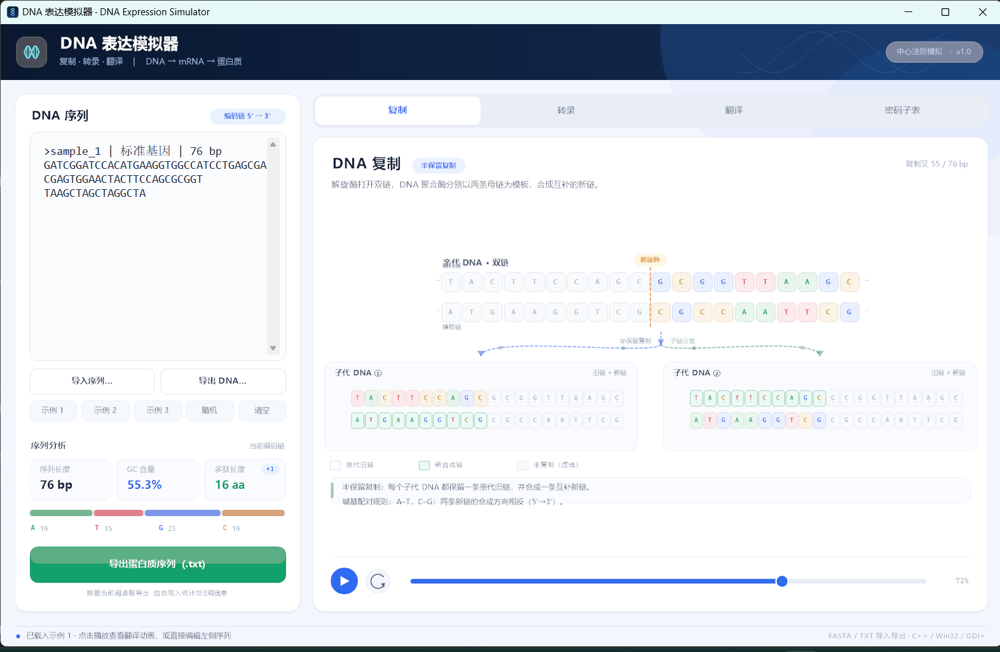
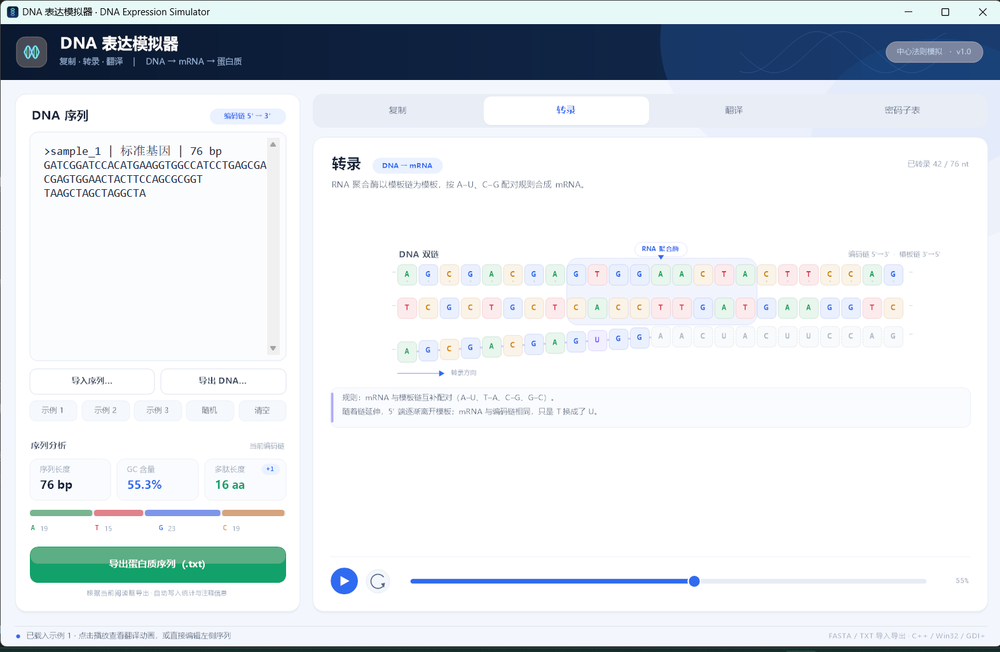
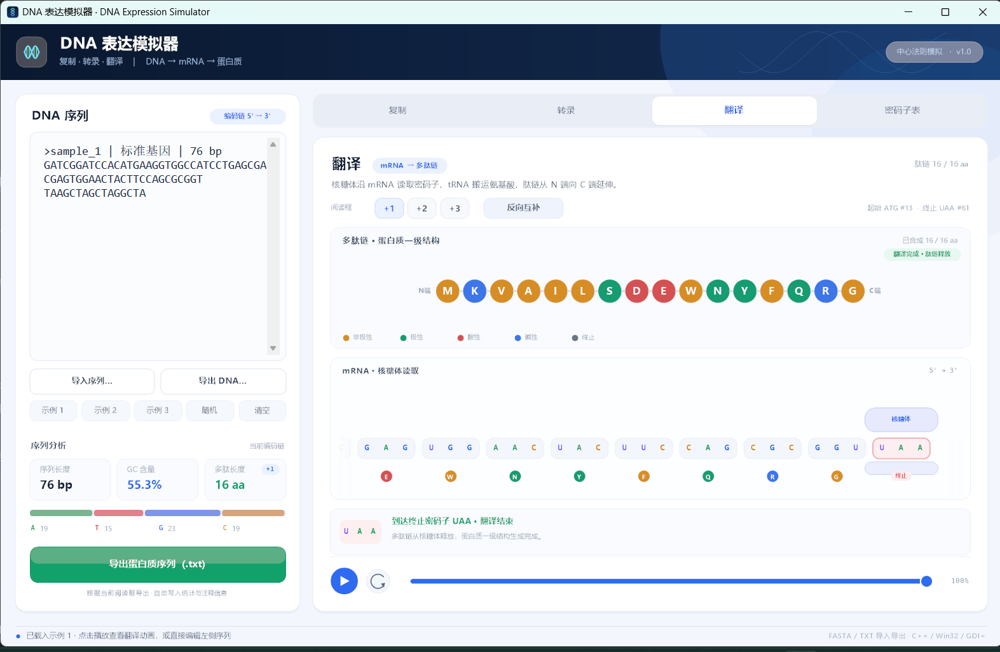
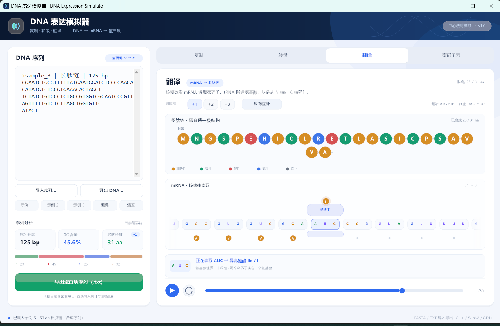

# DNA 表达模拟器 · DNA Expression Simulator

一款原生 Windows 桌面软件，使用 **C++17 + Win32 + GDI+** 编写，无第三方运行时依赖。
软件把一段 DNA 序列转化为可交互的**复制、转录、翻译**可视化，并突出展示**蛋白质的一维结构**。
内置完整密码子表，支持 DNA 序列导入导出与蛋白质序列 TXT 导出。


## 主要功能

| 模块 | 能力 |
| --- | --- |
| DNA 复制 | 半保留复制示意：解旋酶/复制叉移动，亲代双链拆分为两个子代双链；子代双链向外/向下分离，复制叉分叉并伴随分离粒子，旧链与新链分色显示 |
| DNA 转录 | 转录泡、RNA 聚合酶沿模板链移动；mRNA 按 A–U、C–G 配对逐步延伸，5' 端随链延伸逐渐垂离模板，T→U 转换即时可见 |
| 翻译 | 核糖体在密码子间平滑滑行，长链 mRNA 连续滚动；携带氨基酸的 tRNA 进入位点并完成反密码子配对，氨基酸沿弧线从 tRNA 移交入肽链后，空载 tRNA 离去。多肽链以彩色圆珠的一维结构呈现，按性质着色，N 端 → C 端 |
| 密码子表 | 64 个密码子的经典排布；DNA/RNA（T/U）切换；点击查看中文名、三字母/单字母、性质、当前 ORF 使用次数；起始/终止密码子标记 |
| 序列操作 | 输入、粘贴、FASTA/TXT 导入；大小写归一、U→T、去除空白与编号；N 视为未知碱基；长度、GC 含量、碱基组成统计 |
| 阅读框控制 | +1/+2/+3 阅读框；反向互补链（反向链基因）；无 ATG / 无终止密码子时给出明确提示 |
| 动画控制 | 播放 / 暂停 / 重置 / 拖动进度；复制叉、聚合酶、核糖体与进度条实时同步 |
| 导入导出 | 导入 `.txt/.fasta/.fa/.fna`；导出 DNA（FASTA 风格 TXT）；导出蛋白质序列（UTF-8 TXT，含 ORF、密码子、分子量等注释） |
| 其他 | 3 个内置示例、随机合成基因、键盘快捷键、窗口任意缩放、高 DPI 支持、单文件静态链接可执行程序 |

> 翻译规则：在所选阅读框中定位**第一个 ATG**；若没有 ATG，则从阅读框起始处直接翻译并提示。
> 一直翻译到**第一个同框终止密码子**（TAA/TAG/TGA）；无终止密码子时提示蛋白质可能不完整。

## 运行

**方式一（推荐）**：从 [GitHub Releases](https://github.com/Yukinoshita-lin/dna-expression-simulator/releases/latest) 下载 **`DNAExpressionSim.exe`**（Windows 10/11 64 位）并双击运行。程序为静态链接，无需安装或额外 DLL。

**方式二**：按下方“构建”一节在本地生成 `DNAExpressionSim.exe` 后运行。

启动后已载入一个 76 bp 的示例基因，默认停在翻译页约 51% 的动画位置（恰好展示一个氨基酸飞入肽链），可直接点击播放或编辑序列。

### 命令行参数（可选，便于演示与自动化）

```bat
DNAExpressionSim.exe --tab=translation --progress=0.55
DNAExpressionSim.exe --sample=2 --tab=translation --revcomp
DNAExpressionSim.exe --seq=ATGAAGGTGGCCATCCTGAGCGACTAA --tab=transcription
DNAExpressionSim.exe --tab=codons --rna
DNAExpressionSim.exe --sample=1 --export-protein=protein.txt --export-dna=dna.txt --exit
DNAExpressionSim.exe --sample=1 --export-dna=out.txt --force --exit
```

| 参数 | 说明 |
| --- | --- |
| `--tab=replication|transcription|translation|codons` | 启动页 |
| `--sample=1|2|3` | 载入内置示例 |
| `--seq=<序列>` | 载入指定编码链；与 `--sample` 同时给出时以 `--sample` 为准 |
| `--progress=0.0..1.0` | 设置动画初始进度 |
| `--frame=1|2|3` | 阅读框 |
| `--revcomp` | 使用反向互补链作为编码链 |
| `--rna` | 密码子表以 RNA（U）显示 |
| `--play` | 启动后自动播放 |
| `--export-protein=<路径>` / `--export-dna=<路径>` | 无对话框直接导出（可配合 `--exit`） |
| `--force` | 允许命令行导出覆盖已有文件；默认保留已有文件 |
| `--exit` | 导出后退出 |

> 自动化退出码：命令行导出失败返回 `1`；参数错误返回 `2`；成功返回 `0`。导出采用同目录临时文件写入并原子替换；未加 `--force` 时不会覆盖已有文件。

## 使用说明

1. **输入序列**：在左侧编辑框粘贴或输入编码链（5'→3'）。支持 A/T/G/C/U/N；FASTA 标题行（`>` 开头）、空白、数字会被自动忽略，U 会按 T 处理。
2. **导入 / 导出**：`导入序列…` 读取 FASTA/TXT；`导出 DNA…` 将当前编码链写为 FASTA 风格 TXT；绿色按钮导出当前阅读框对应的蛋白质 TXT。
3. **选择阅读框**：翻译页顶部 `+1 +2 +3` 切换阅读框；`反向互补` 用于反向链上的基因。任何修改都会自动重新寻找 ORF。
4. **动画**：底部的播放/暂停按钮开始或暂停动画；拖动进度条任意定位；鼠标点击密码子表单元格查看详情。
5. **快捷键**：`Space` 播放/暂停，`←/→` 步进 2%，`Home/End` 跳到起点/终点（编辑框获得焦点时快捷键不生效）。




<p align="center">
  
  <br/>
  <em>到达终止密码子：多肽链释放，一级结构完整呈现</em>
</p>

<p align="center">
  
  <br/>
  <em>长肽链自动换行；示例 3 为 31 aa 的合成序列</em>
</p>

## 动画细节

- **核糖体插值**：读取密码子时先停留，再用 smoothstep 在后 45% 的区间滑向下一个密码子；长序列采用连续相机，密码子条从核糖体下方平滑滚过，不再整页跳动。
- **氨基酸入链**：携带氨基酸的 tRNA 先从右侧进入核糖体 A 位点；反密码子按 3'→5' 方向与当前 5'→3' 密码子互补配对。当读取进度达到密码子的 35% 时，氨基酸从 tRNA 3' 端脱离，沿二次贝塞尔弧线飞向肽链末端；空载 tRNA 随后向左侧淡出离去。
- **子链分离**：复制叉向下分出两条子代 DNA，子代面板随进度向外、向下漂移，绿色/灰色粒子沿分叉路径运动；转录时 mRNA 的 5' 端越“老”越向下垂，形成与模板逐渐脱离的可视曲线。

## 密码子表

64 个密码子按“第 1·2 位为行、第 3 位为列”的经典方式排布；点击任意单元格查看详情。
蓝色底色表示当前 ORF 使用过该密码子，`×N` 为使用次数；起始密码子 ATG 会额外标记。


## 文件格式

### DNA 导入

- 纯序列文本（可选 FASTA 头），大小写不敏感；
- 自动忽略空白、换行、数字、`-`、`.`、`_`；
- 支持 U→T；字母 N 表示未知碱基；
- 不支持的字母（如 B、X）会在左侧红色提示中指出。

### DNA 导出（TXT）

```
>DNA_sequence | length=76 bp | GC=55.3% | coding strand 5'-3'
GATCGGATCCACATGAAGGTGGCCATCCTGAGCGACGAGTGGAACTACTTCCAGCGCGGT
TAAGCTAGCTAGGCTA
```

### 蛋白质导出（TXT，UTF-8 BOM）

```
; DNA 表达模拟器 · 蛋白质序列导出
; 导出时间：2026-11-19 20:33
; 来源：编码链 5'->3' （正向），DNA 长度 76 bp，GC 55.3%
; 阅读框：+1，起始密码子 ATG 位置 13，终止密码子 TAA（UAA）位置 61
; 氨基酸数：16 aa，预测分子量：1957.2 Da
>protein_1
MKVAILSDEWNYFQRG

; 三字母表示：
; Met Lys Val Ala Ile Leu Ser Asp Glu Trp Asn Tyr Phe Gln Arg Gly
```

> 若当前使用反向互补链，导出的 DNA 和蛋白质均基于“当前编码链”，并在蛋白质注释中注明。
> 文本以 CRLF 换行，蛋白质文件带 UTF-8 BOM，便于 Windows 记事本直接打开。
> GUI 保存对话框仍会先确认覆盖；所有导出都会先写入同目录临时文件，完整刷新后再替换目标文件。

## 构建

环境要求：**MinGW-w64 g++（C++17）**、`windres`。本机验证版本为 g++ 15.2.0（x86_64-w64-mingw32）。
构建脚本会自动尝试 `C:\mingw64\bin` 与 `C:\msys64\mingw64\bin`；其他位置可通过环境变量 `MINGW_BIN` 指定。

```bat
build.bat
```

或手动执行：

```bat
windres -i src\app.rc -o build\app_res.o --include-dir=src
g++ -std=c++17 -O2 -Wall -Wextra -Wpedantic -DUNICODE -D_UNICODE -mwindows ^
    src\main.cpp src\ui.cpp src\views.cpp src\genetics.cpp src\textfile.cpp src\fileio.cpp build\app_res.o ^
    -o DNAExpressionSim.exe ^
    -lgdiplus -lcomdlg32 -lcomctl32 -lshell32 -lgdi32 -luser32 -lwinmm ^
    -static -static-libgcc -static-libstdc++
```

Git Bash / MSYS2 下可执行 `./build.sh`。

## 测试

```bat
test.bat
```

控制台单元测试分两层：

- `tests/test_genetics.cpp`：64 密码子与标准遗传密码逐项比对、序列清洗（含非法小写字母）、U→T、N、互补/反向互补/转录、ORF 定位、阅读框、终止密码子、立即终止、分子量、导出文本（含未知氨基酸 X）、随机基因等，共 **48 项**；
- `tests/test_textfile.cpp`：原子写入、Unicode 路径、读取完整性、禁止覆盖、显式覆盖、UTF-8 BOM 与失败路径，共 **12 项**。

```text
58 passed, 0 failed
```

构建成功后还可运行 CLI 集成测试：

```bat
tests\test_cli.bat
```

它验证命令行导出、退出码（成功 `0`、导出失败 `1`、参数错误 `2`）、默认不覆盖、`--force` 覆盖和临时文件清理，共 **13 项**。`test.sh` 在 MSYS2 / Git Bash 下提供相同的单元测试入口。

## 持续集成

仓库包含 `.github/workflows/build.yml`，在 Windows runner 上依次安装 MinGW-w64、运行单元测试、构建应用、执行 CLI 集成测试，并上传 `DNAExpressionSim.exe` 构件。

## 项目结构

```
DNA/
├─ LICENSE / NOTICE          # Apache-2.0 许可证与版权声明
├─ src/
│  ├─ genetics.h/.cpp        # 纯 C++ 遗传学核心（密码子表、复制、转录、翻译、导出文本）
│  ├─ app.h                  # 应用状态与布局/接口
│  ├─ main.cpp               # Win32 窗口、布局、交互、动画、绘制框架
│  ├─ ui.h/.cpp              # 主题、字体缓存、GDI+ 小工具
│  ├─ views.cpp              # 复制 / 转录 / 翻译 / 密码子表四视图
│  ├─ textfile.h/.cpp        # 与界面无关的文件读取和原子写入
│  ├─ fileio.cpp             # 文件对话框、UTF-8/UTF-16 读取、TXT 写出
│  ├─ app.rc / app.manifest / app.ico
├─ tests/
│  ├─ test_genetics.cpp      # 遗传学核心单元测试（48 项）
│  ├─ test_textfile.cpp      # 文件读写单元测试（12 项）
│  ├─ test_cli.ps1/.bat      # 命令行与导出集成测试（13 项）
├─ samples/                  # 可直接导入的 FASTA 示例
├─ docs/                     # README 截图
├─ assets/                   # 应用图标源文件
├─ tools/                    # 图标生成与截图脚本（开发用，依赖见 requirements.txt）
│                            # Python 图标脚本依赖：python -m pip install -r tools\requirements.txt
├─ build.bat / build.sh
├─ test.bat / test.sh
└─ README.md
```

## 性能与实现

程序不逐帧重画整个窗口，而是采用分层绘制：

- **静态层缓存**：页头、左栏、卡片底与标签栏只在一开始或序列/布局变化时渲染一次；
- **脏区重绘**：动画只重绘右侧卡片与页脚中真正变化的区域，并同时设置 GDI 与 GDI+ 裁剪；
- **GDI DIB + BitBlt**：双缓冲使用 32 位 DIB 与 `BitBlt`，避免每帧 GDI+ `DrawImage` 的全窗转换；
- **定时器**：`timeBeginPeriod(1)` + 10ms 定时器，实测动画帧间隔约 **15.6–16.4ms（约 60fps）**；翻译/转录逐帧绘制约 3–6ms，复制视图最重约 8–16ms，位块拷贝 < 0.5ms；
- **输入防抖**：编辑框停止输入 180ms 后才重新翻译并刷新统计，避免逐键触发整层重建；点击播放/导出等操作会先立即刷新待处理输入。

> 这类界面卡顿通常不是 C++ 的问题，而是“每帧全窗重画 + GDI+ 软件光栅化 + 多层阴影/每帧新建大位图”造成的。上述改动把大窗口动画从约 25–47ms/帧降到约 16ms/帧。程序仍使用 GDI+ 绘制，因此在 144Hz 显示器上锁在约 60fps，而非 144fps。

## 科学说明与边界

- 使用**标准核遗传密码**（64 项，3 个终止密码子）。
- 翻译取所选阅读框内的**第一个 ATG**；软件不做剪接、启动子识别、甲基化或可变剪接模拟。
- 由于只展示一维结构，不进行三维折叠、二级结构（α 螺旋/β 折叠）预测。
- 蛋白质分子量由残基平均质量之和加一分子水估算，约到 0.1 Da，仅作教学参考。
- 翻译结果含 N（未知碱基）时，对应氨基酸为 `X`；导出不显示“完整分子量”，只给出已知残基与水的质量下限，避免误读。
- N（未知碱基）在翻译中输出为 `X`，不被视为终止密码子。
- 序列长度上限 30,000 bp；长序列在视图中采用滑动窗口显示，导出仍针对完整序列。
- 复制与转录动画为教学示意，不模拟冈崎片段、拓扑异构酶等全部细节。

## 环境与验证

- Windows 11，125% DPI，1920×1080 实际分辨率；
- 已使用截图逐页检查四个视图、空序列/非法字符、反向互补、无起始密码子、动画播放与完成状态；
- 已通过真实文件对话框验证 FASTA 导入与 DNA/蛋白质 TXT 导出；
- 已在 125% DPI 缩放下逐页截图检查布局与文字清晰度；窗口最小尺寸按 1160×720 逻辑像素设计。

## License

本项目采用 **Apache License 2.0** 许可。详见 [LICENSE](LICENSE) 与 [NOTICE](NOTICE)。

Copyright 2026 Yukinoshita-lin.
